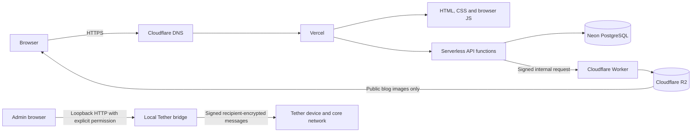
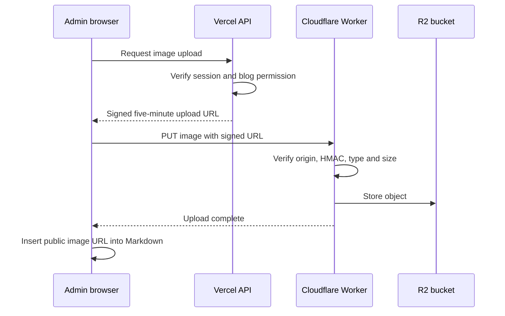
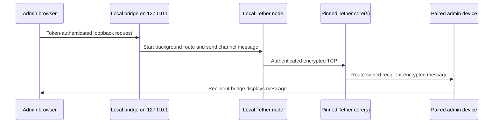

# Portfolio Backend and Infrastructure Guide

This document describes how the portfolio works from the browser through DNS, Vercel, Neon, and Cloudflare. It is the operational reference for deploying, maintaining, backing up, and troubleshooting the site.

`README.md` is intentionally separate and is not replaced by this guide.

## 1. System overview

The public site is mostly HTML, CSS, and browser JavaScript. Vercel serves those files and runs the server-side JavaScript files under `api/` as serverless functions. Neon stores structured text and settings. Cloudflare provides authoritative DNS and R2 object storage. Porkbun remains the registrar for the domain.



The main responsibilities are:

| Service | Responsibility |
| --- | --- |
| Porkbun | Domain registration and renewal for `basanta.cc` |
| Cloudflare DNS | Authoritative DNS for the domain |
| Vercel | Static hosting, serverless API functions, HTTPS, redirects, and GitHub deployments |
| Neon | PostgreSQL data for posts, projects, users, settings, and admin presence |
| Cloudflare Worker | Validates signed blog-image uploads |
| Cloudflare R2 | Stores public blog images |
| Tether / NeoNet | Carries signed, recipient-encrypted admin messages between participating devices |
| Local Tether bridge | Lets the admin page use the Tether node running on the same computer |
| GitHub | Source history and the deployment source used by Vercel |

## 2. Domains and DNS

### Registrar

`basanta.cc` is registered at Porkbun. Porkbun controls ownership and renewal, but it is not the active DNS host. The authoritative nameservers at Porkbun must remain:

- `dora.ns.cloudflare.com`
- `elliot.ns.cloudflare.com`

Changing the nameservers back to Porkbun would bypass the Cloudflare DNS records and could show Porkbun's parking page.

### Public hostnames

| Hostname | Purpose |
| --- | --- |
| `www.basanta.cc` | Canonical website address on Vercel |
| `basanta.cc` | Redirects to `https://www.basanta.cc/` |
| `media.basanta.cc` | Public custom domain for the R2 bucket used by blog images |
| `basanta.space` and `www.basanta.space` | Legacy addresses that should redirect to `www.basanta.cc` |

Use the DNS values currently shown by Vercel when changing Vercel records. Do not copy old IP addresses from this document because Vercel can change its recommended records.

The R2 custom-domain record is managed by Cloudflare and remains proxied. Vercel DNS records should follow Vercel's current instructions. When Vercel says a CNAME must be DNS-only, do not enable the Cloudflare proxy for that record.

### Preventing migration cache problems

When moving DNS providers, create equivalent records at the old and new providers before changing nameservers, then keep both configurations valid for at least 48 hours. DNS and TLS are resolved before website code runs, so no HTML or JavaScript can repair a stale resolver.

This workstation's wired connection is configured to ignore the router's DNS and use Cloudflare resolvers directly:

- IPv4: `1.1.1.1`, `1.0.0.1`
- IPv6: `2606:4700:4700::1111`, `2606:4700:4700::1001`

## 3. Repository and deployment flow

There are two local copies:

| Location | Purpose |
| --- | --- |
| `~/Desktop/Codex-Prjs/Portfolio` | Working copy where Codex changes are made |
| `~/Desktop/Submitted- Prjs/Portfolio` | Main Git checkout connected to GitHub and Vercel |

`~/port.sh` copies the working copy into the main checkout with `rsync --delete`, then asks for a commit message, commits, and pushes.

The script deliberately preserves:

- `.git/`
- `.vercel/`
- `node_modules/`
- `.env`
- `.env.local`
- `.env*.local`

Because it uses `--delete`, a file that exists only in the main checkout would normally be removed. Before syncing after independent edits or GitHub changes, pull and run a dry comparison:

```bash
cd "$HOME/Desktop/Submitted- Prjs/Portfolio"
git pull --ff-only

rsync -rcni --delete --itemize-changes \
  --exclude='.git/' \
  --exclude='.vercel/' \
  --exclude='node_modules/' \
  --exclude='.env' \
  --exclude='.env.local' \
  --exclude='.env*.local' \
  "$HOME/Desktop/Codex-Prjs/Portfolio/" \
  "$HOME/Desktop/Submitted- Prjs/Portfolio/"
```

Any output beginning with `*deleting` needs review before running `port.sh`.

After `git push`, Vercel automatically creates a deployment from the GitHub repository. Production should use `www.basanta.cc` as its primary domain and redirect the apex domain to it.

## 4. Vercel

Vercel has two jobs:

1. Serve the static pages and assets.
2. Execute JavaScript files inside `api/` as serverless functions.

The repository uses native ES modules. `package.json` contains one runtime dependency, `@neondatabase/serverless`, which provides the Neon SQL client. Vercel installs this dependency during deployment. Normal maintenance for this project does not require running npm, pnpm, bun, or npx locally.

`vercel.json` currently contains the route normalization for `/admin/Home`. Domain redirects are managed through Vercel's project-domain settings.

### Vercel environment variables

These values belong in Vercel Project Settings under Environment Variables. Add them to Production and any Preview environment that should support the backend.

| Variable | Purpose |
| --- | --- |
| `DATABASE_URL` | Neon PostgreSQL connection string |
| `JWT_SECRET` | Signs admin session cookies |
| `ADMIN_USERNAME` | Bootstrap username for the first super admin |
| `ADMIN_PASSWORD_HASH` | Scrypt hash for the bootstrap super-admin password |
| `R2_UPLOAD_URL` | Base URL of the Cloudflare upload Worker |
| `R2_UPLOAD_SECRET` | Shared HMAC secret for signed blog-image uploads |
| `R2_PUBLIC_BASE_URL` | Public R2 domain, normally `https://media.basanta.cc` |

Never put the raw admin password, database password, session secret, or upload secret in Git.

## 5. Neon PostgreSQL

`lib/db.js` creates the Neon client from `DATABASE_URL`. SQL calls use tagged templates so user-supplied values are sent as parameters instead of being joined into query strings.

`sql/schema.sql` documents the database schema. Several server modules also create their required tables safely with `CREATE TABLE IF NOT EXISTS`, which allows existing deployments to gain new tables without destructive migrations.

### Tables

#### `posts`

Stores blog text:

- title
- unique slug
- excerpt
- Markdown content
- publication timestamp
- last-edited timestamp

Images are not stored in this table. Markdown content contains the public R2 image URL.

#### `projects`

Stores all public projects:

- name
- subtitle or short description
- optional GitHub URL
- optional additional links as JSON
- categories as JSON
- creation and edit timestamps

All current projects are stored in the database and can be edited or deleted from the admin Projects tab. Both the public page and the admin list read `/api/projects`; normal requests never import default records.

The public page shows loading, empty, and retry states instead of a hardcoded fallback. Deleting a project therefore cannot make it reappear during an API failure. The optional historical import is archived in `scripts/migrations/import-legacy-projects.mjs` for explicit use on a fresh database; its existing `default_projects_v1` marker prevents repeat imports.

#### `admin_users`

Stores admin identities:

- unique username
- scrypt password hash
- role: `super` or `admin`
- feature permissions as JSON
- enabled or disabled state
- authentication version
- timestamps

Incrementing `auth_version` invalidates older sessions after a password change.

#### `site_settings`

Stores JSON settings by key. It currently holds the Tether visibility/download controls and the one-time project-import marker.

#### `admin_presence`

Stores one last-seen timestamp per admin account. A dashboard heartbeat updates it every 25 seconds. An account is shown online for 75 seconds after its most recent heartbeat. Logging out removes the presence row immediately. Closing a browser without logging out can therefore take about a minute to appear offline.

Chat message content is not stored in Neon.

## 6. Authentication and authorization

### Passwords

Passwords are hashed with Node's built-in scrypt implementation and a random salt. The database and environment variables contain only the encoded salt and hash.

### Sessions

Successful login creates an HMAC-signed session token in an `HttpOnly`, `Secure`, `SameSite=Strict` cookie. Browser JavaScript cannot read that cookie.

- Standard session: 12 hours and ends with the browser session cookie.
- “Remember me”: persistent cookie for 30 days.

Every protected API request reloads the admin account from Neon and verifies that it is enabled and that its authentication version still matches the token.

### Roles

Super admins can:

- manage blog posts
- manage projects
- view Tether downloads
- change public Tether settings
- create, edit, disable, and delete admin accounts
- change their own password
- use admin chat

Normal admins receive selected permissions for blog posts, projects, and Tether. API functions enforce those permissions on the server; hiding a tab in the browser is only a usability feature. All authenticated admins can use the Tether-backed admin chat and presence list.

The API prevents deleting the account currently in use and prevents removing the final active super admin.

## 7. Blog system

The public blog page calls `GET /api/posts`. Individual pages call `GET /api/posts/[slug]` and render stored Markdown safely into the terminal-style layout.

Authorized blog admins can:

- publish a post
- edit a post while keeping its slug
- delete a post
- download a post as a Markdown file with front matter
- upload an image without manually finding a URL

An edited post receives `updated_at = now()`, which is displayed next to its original publication date.

### Image-upload flow



Allowed image formats are PNG, JPEG, GIF, WebP, and AVIF. The maximum accepted size is 3 MB. Object names contain a random UUID and receive an immutable one-year public cache header.

## 8. Project system

The public page calls `GET /api/projects`, then builds project cards using DOM methods and `textContent`. Search matches names, descriptions, categories, and links.

Authorized project admins can create, edit, and delete projects. New projects require one to three categories. Previously used and built-in categories are offered in the category selector.

Project links are validated before being placed in the public page. Only HTTP and HTTPS links are rendered.

## 9. Tether and NeoNet controls

The release manifest lives at `tether/downloads/latest.json`. The public page uses it to show platform support and downloads.

Super admins control three independent settings:

1. Show or replace the Tether page with “Coming soon.”
2. Show or hide Tether in every navbar.
3. Enable or disable downloads while still showing every platform and its support status.

Normal admins with Tether permission can view the release information but cannot change the public switches.

## 10. Tether admin chat

The admin dashboard provides a chat tab for every authenticated admin. Message bodies do not use a Vercel API, Neon, a Cloudflare Worker, or R2. Each participating computer runs `tether-web-bridge.py`, which listens only on `127.0.0.1` and invokes the installed Tether/NeoNet command without a shell.



On Linux, `start-tether-admin-chat.sh` is the normal setup path. The user runs this downloaded launcher once. It downloads the published AppImage and local bridge over HTTPS, verifies their pinned SHA-256 hashes, installs them under the user's local data directory, starts the bridge on an unused loopback port, verifies its authenticated status endpoint, and reopens the admin chat with a one-time fragment token and port. URL fragments are not sent to Vercel. The page immediately removes the values from the address bar and keeps them in that tab's `sessionStorage`. Choosing an unused port allows the launcher to coexist with an older bridge or another local service.

Browsers are not permitted to silently execute a downloaded program, so running the launcher remains an operating-system action. The manual bridge-token field remains available for development and non-Linux installations. Every bridge request requires the random token, and the bridge accepts only the production site and local development origins.

The bridge starts the saved Tether background route with `neonet up`. Every other participant must run Tether and complete its one-time device pairing. Devices on separate networks also need at least one reachable, pinned Tether core. GitHub distributes Tether source and releases; it is not a message transport.

Web-chat messages contain a signed application expiry and are shown for 24 hours. The bridge removes expired web-chat entries from its outbox and local Tether channel logs whenever it starts or receives a request. It never deletes unrelated Tether messages. A recipient that receives an already expired envelope does not display it. Core queues remain bounded by Tether; the current protocol may retain encrypted, unreadable queued ciphertext until delivery or queue eviction, so strict relay-side deletion requires a future protocol-level TTL understood by every core.

Each message is limited to 1,000 characters. Enter sends, Shift+Enter inserts a newline, and the UI uses `textContent`, preventing message HTML or JavaScript injection.

## 11. Cloudflare R2 and cost control

The bucket binding is named `BLOG_IMAGES` and currently points to `basanta-blog-images`. It stores public blog images only.

The current free R2 Standard allowance shown for this account is:

- 10 GB-month of Standard storage
- 1 million Class A operations per month
- 10 million Class B operations per month
- zero Internet egress fees

These allowances reset monthly and do not accumulate. Confirm current limits in the Cloudflare dashboard because provider pricing can change.

Use Standard storage. The free allowance does not apply to Infrequent Access storage. Keep images compressed, retain the 3 MB upload limit, and check the R2 usage dashboard monthly. Cloudflare does not provide a guaranteed hard spending stop, so keep a low billing alert configured.

Admin chat does not use R2. Only blog images count toward this bucket's storage and operation usage.

## 12. Browser JavaScript

The site deliberately uses browser-native JavaScript instead of a frontend framework.

Important files include:

| File | Responsibility |
| --- | --- |
| `theme.js` | Dark/light theme state and toggle behavior |
| `site-settings.js` | Applies the public Tether navbar setting |
| Admin project editor | Category suggestions from existing database projects |
| `admin/admin-access.js` | Admin roles, user management, Tether controls, presence, and chat |
| `blog/index.html` scripts | Post loading, progress display, and fuzzy search |
| `blog/post.html` scripts | Individual post loading and Markdown rendering |
| `projects/index.html` scripts | Database project cards and fuzzy search |
| `tether/releases.js` | Release/platform display and public Tether controls |

Dynamic user content is placed into the page using DOM creation and `textContent`. URLs are parsed and protocol-checked before they become links.

## 13. API inventory

| Route | Main methods | Access |
| --- | --- | --- |
| `/api/login` | POST | Public credentials endpoint |
| `/api/logout` | POST | Logged-in session; also clears presence |
| `/api/session` | GET, POST | GET returns session status; POST updates and lists admin presence |
| `/api/change-password` | POST | Super admin |
| `/api/admin-users` | GET, POST | Super admin |
| `/api/admin-users/[id]` | PUT, DELETE | Super admin |
| `/api/posts` | GET, POST | GET public; POST requires blog permission |
| `/api/posts/[slug]` | GET, PUT, DELETE | Reading public; changes require blog permission |
| `/api/projects` | GET, POST | GET public; POST requires project permission |
| `/api/projects/[id]` | GET, PUT, DELETE | Reading public; changes require project permission |
| `/api/uploads/blog-image` | POST | Blog permission |
| `/api/tether-settings` | GET, PUT | GET public; PUT requires super admin |

Admin messages deliberately have no hosted API route. The browser uses token-authenticated local bridge endpoints on a launcher-selected `127.0.0.1` port. Manual development setup defaults to port `7331`.

## 14. Backups and recovery

### Git and static files

GitHub is the backup and history for source code and static assets. R2 objects and Neon data are not stored in Git.

### Neon

Periodically export the following tables:

- `posts`
- `projects`
- `admin_users`
- `site_settings`

`admin_presence` is temporary and does not need backup.

Treat a database export as sensitive because it contains password hashes and admin metadata. Store it privately and encrypted.

### Cloudflare R2

Blog images should be backed up if they cannot be recreated. Admin chat intentionally expires and is not part of the site backup.

### Secret recovery

- Losing `JWT_SECRET` logs everyone out after replacement but does not delete content.
- Losing `R2_UPLOAD_SECRET` stops new image uploads until the same replacement is installed in Vercel and Cloudflare.
- Losing the bootstrap password does not matter after a database super admin exists, provided another super admin can reset the account.

## 15. Safe deployment checklist

1. Pull the main Git checkout with `git pull --ff-only`.
2. Run the deletion-aware `rsync` dry run shown earlier.
3. Confirm `README.md` and any files edited directly in the main checkout are preserved.
4. Run `node --test` in the working copy.
5. Run `~/port.sh` and provide a short commit message.
6. Watch the Vercel production deployment until it succeeds.
7. If Worker code changed, deploy `cloudflare/blog-image-worker/src/index.js` to `basanta-blog-image-upload` and preserve its `BLOG_IMAGES` binding.
8. Confirm all Worker secrets are present.
9. Test login, blog loading, project loading, image upload, admin presence, chat, and logout.
10. Test both `https://basanta.cc/` and `https://www.basanta.cc/` in a clean browser session.

## 16. Troubleshooting

### Porkbun parking page or TLS errors

Check authoritative nameservers first:

```bash
dig NS basanta.cc +short
```

The result should be the Cloudflare nameservers, not Porkbun nameservers. Then compare the default resolver with a public resolver:

```bash
dig A www.basanta.cc +short
dig @1.1.1.1 A www.basanta.cc +short
```

If Cloudflare is correct but the default result is old, the device, router, or ISP resolver has stale DNS.

### Admin redirects to login

Check that the session cookie exists, `JWT_SECRET` has not changed, the account is enabled, and its `auth_version` still matches. A password change intentionally invalidates old sessions.

### Blog or projects do not load

Check the Vercel function logs and the `DATABASE_URL` environment variable. Confirm the Neon database is awake and the required tables exist.

### Images do not upload

Confirm `R2_UPLOAD_URL`, `R2_UPLOAD_SECRET`, and `R2_PUBLIC_BASE_URL` in Vercel. Confirm the Worker has the matching `UPLOAD_SECRET` and the `BLOG_IMAGES` R2 binding.

### Chat cannot reach the local Tether bridge

Keep the bridge terminal open and paste its current token into the admin page. Confirm Tether is installed, the selected device is paired, and `neonet control` works. If the browser asks for local-network access, allow it for `basanta.cc`. A remote send also needs a running background route and a reachable pinned core.

### Admin incorrectly appears online

Presence expires automatically after 75 seconds. Logging out clears it immediately, while closing the tab without logging out waits for expiration.

## 17. Security rules

- Never commit `.env`, `.env.local`, database URLs, API secrets, encryption keys, or raw passwords.
- Never send secrets through chat, screenshots, issue trackers, or commit messages.
- Use separate random values for every secret.
- Keep at least one active super admin.
- Give normal admins only the features they need.
- Rotate a shared secret in both services during the same maintenance window.
- Treat database exports and encrypted R2 backups as private.
- Review Vercel and Cloudflare logs after unexplained authentication or upload failures.
